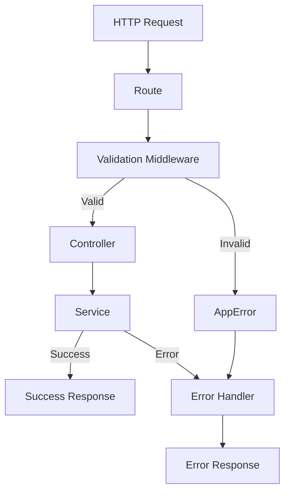

# Backend Development Conventions

## Stack

- Runtime: Node.js
- Language: TypeScript
- Framework: Express
- ORM: Prisma
- Database: PostgreSQL
- Package manager: npm
- API style: REST
- API versioning: `/api/v1`

## Architecture

Use a modular, feature-based architecture.****

Each business feature must have its own module.

Example:

```text
src/
├── modules/
│   ├── auth/
│   ├── users/
│   ├── products/
│   ├── categories/
│   ├── inventory/
│   └── transactions/
├── middlewares/
├── config/
├── lib/
├── app.ts
└── index.ts
```

Do not organize the entire application by technical layer such as:

```text
controllers/
services/
repositories/
models/
```

Instead, organize code by feature.

## Module Structure

Each module should contain only the files required by that feature.

Typical structure:

```text
modules/
└── products/
    ├── dto/
    │   ├── create-product.dto.ts
    │   ├── update-product.dto.ts
    │   ├── get-products-query.dto.ts
    │   └── product-params.dto.ts
    ├── product.route.ts
    ├── product.controller.ts
    ├── product.service.ts
    └── product.types.ts
```

Not every module must contain all of these files.

Only create a file when the feature actually needs it.

For example, do not create `product.types.ts` if there are no module-specific types.

## Request Flow

The standard request flow is:



Each layer has a specific responsibility.

### Route

Routes define:

- HTTP method
- URL
- Middleware
- Controller handler

Example:

```ts
router.post(
  "/",
  validate(createProductSchema),
  productController.create
);
```

Routes must not contain business logic or database queries.

### Controller

Controllers are responsible for handling HTTP concerns:

- Reading request parameters, query strings, and request bodies
- Reading authenticated user information when needed
- Calling the appropriate service
- Returning HTTP responses
- Forwarding errors to the centralized error handler using `next(error)`

Controllers should not contain business logic or handle errors by constructing HTTP error responses manually. Business errors should be thrown by the service and forwarded to the centralized error handler.

Example:
```ts
export async function createProduct(
  req: Request,
  res: Response,
): Promise<void> {
  const product = await createProductService(
    req.body as CreateProductDto,
  );

  res.status(201).json({
    message: "Product created successfully.",
    data: product,
  });
}
```
Controllers should remain thin and focus on HTTP concerns.

- Do not put business logic directly inside controllers.
- Simple, straightforward Prisma queries may be placed directly in controllers when doing so avoids unnecessary service wrappers.
- Queries involving business rules, complex filtering, multiple database operations, or reusable operations should be handled by services.
- Allow errors to propagate to the centralized error-handling middleware. Express 5 automatically forwards errors thrown by asynchronous route handlers and rejected promises, so `next(error)` is not needed solely for error propagation.

Prefer simplicity over unnecessary abstraction while keeping business logic separate from HTTP concerns.

### Service

Services handle business logic and database operations when additional logic or abstraction is needed.

Simple, straightforward Prisma queries may be handled directly in controllers to avoid unnecessary service wrappers.

Example:

```ts
// product.service.ts
export async function createProduct(data: CreateProductInput) {
  const existingProduct = await prisma.product.findUnique({
    where: { sku: data.sku },
  });

  if (existingProduct) {
    throw new AppError(
      409,
      ERROR_CODES.CONFLICT,
      "Product SKU already exists.",
    );
  }

  return prisma.product.create({
    data,
  });
}
```

Services may:

- Validate business rules and enforce business constraints.
- Query Prisma and perform database operations.
- Create, update, and delete records.
- Execute database transactions.
- Coordinate multiple database operations.
- Call other services when necessary.
- Throw `AppError` for expected application errors, using the appropriate error code from the centralized `ERROR_CODES` definition.

**Guidelines:**

- Do not create service functions solely to wrap simple Prisma queries without meaningful value.
- Keep business logic out of controllers.
- Use services for operations involving business rules, multiple operations, transactions, or reusable logic.
- Throw `AppError` for expected errors instead of returning HTTP responses or throwing plain `Error` objects for known application failures.
- Use `ERROR_CODES` from the centralized error definitions. Do not hardcode error code strings.
- Let the centralized error handler convert application errors into HTTP responses.
- Services must not handle HTTP requests or responses.


## No Repository Layer

Do NOT create repositories.

The project intentionally uses:

```text
Controller → Service → Prisma
```

Do not introduce:

```text
Controller → Service → Repository → Prisma
```

Do not create files such as:

```text
product.repository.ts
user.repository.ts
transaction.repository.ts
```

Prisma is already the data access layer.

Keep database access inside the service.

## Prisma

Use a shared Prisma client.

The Prisma client should be initialized in:

```text
src/lib/prisma.ts
```

Example:

```ts
import { PrismaClient } from "@prisma/client";

export const prisma = new PrismaClient();
```

Do not create a new `PrismaClient` inside individual services.

Do not access Prisma directly from routes or controllers.

Correct:

```text
Controller
    ↓
Service
    ↓
Prisma
```

Incorrect:

```text
Controller
    ↓
Prisma
```

## Database Transactions

Use `prisma.$transaction()` whenever an operation modifies multiple related records and must succeed or fail atomically.

For example, a POS sale may involve:

```text
Transaction
Transaction Items
Stock Movement
Stock Update
```

These operations should be executed within one database transaction when consistency requires it.

Example:

```ts
await prisma.$transaction(async (tx) => {
  // Create transaction
  // Create transaction items
  // Create stock movements
  // Update stock
});
```

Do not allow partial updates that can leave the database in an inconsistent state.

## Validation

Validate external input before it reaches business logic.

Validation should happen through middleware/schema validation.

Example:

```text
Request
  ↓
Validation
  ↓
Controller
  ↓
Service
```

Use the project's existing validation library and conventions.

Do not duplicate the same validation logic across multiple controllers.

## API Versioning

All API endpoints must use the version prefix:

```text
/api/v1
```

Examples:

```text
GET    /api/v1/products
GET    /api/v1/products/:id
POST   /api/v1/products
PATCH  /api/v1/products/:id
DELETE /api/v1/products/:id
```

Use RESTful resource naming.

Prefer:

```text
GET /api/v1/products
POST /api/v1/products
```

Avoid action-based endpoints such as:

```text
GET /api/v1/getProducts
POST /api/v1/createProduct
```

Action-based endpoints are allowed only when the operation cannot reasonably be represented as a standard REST resource operation.

## Response Format

Successful responses should use:

```json
{
  "data": {}
}
```

Collection responses should use:

```json
{
  "data": [],
  "meta": {
    "page": 1,
    "limit": 20,
    "total": 100
  }
}
```
## Error Response Format

All modules must use a consistent error response format.

Example:

```json
{
  "code": "VALIDATION_ERROR",
  "message": "Request validation failed.",
  "errors": [
    {
      "field": "phoneNumber",
      "code": "invalid_type",
      "message": "Invalid input: expected string, received undefined"
    }
  ]
}
```

- `code`: A stable application error code.
- `message`: A human-readable error message.
- `errors`: Optional details for validation errors or other errors that require additional information.

For errors without additional details, omit the `errors` field.

## Error Handling

Use the application's centralized error-handling middleware to handle application errors and unexpected errors consistently.

- Avoid repetitive `try/catch` blocks in controllers unless special error handling is required.
- Services should throw `AppError` when business rules are violated or expected application errors occur.
- Use error codes from the centralized `ERROR_CODES` definition. Do not hardcode error code strings.
- Controllers should not manually construct or format error responses.
- The centralized error handler is responsible for determining the HTTP status code and formatting the error response.
- Unexpected errors should return a generic internal server error without exposing sensitive implementation details.

Example:

```ts
throw new AppError(
  404,
  ERROR_CODES.NOT_FOUND,
  "Product not found",
);
```

For resource-specific errors, add dedicated codes such as `PRODUCT_NOT_FOUND` to `ERROR_CODES` when needed.

## Controller Error Propagation

Controllers should allow errors to propagate to the centralized error-handling middleware.

Express 5 automatically forwards errors thrown by asynchronous route handlers and rejected promises to the error-handling middleware.

- Do not use repetitive `try/catch` blocks solely to forward errors.
- Use `try/catch` only when specific error handling or recovery is required.
- Do not manually format error responses in controllers. Let the centralized error handler handle error responses consistently.
- 
## Error Handling

Use the application's centralized error-handling middleware to handle application errors and unexpected errors consistently.

- Do not use repetitive `try/catch` blocks in every controller unless the error requires special handling.
- Services should throw `AppError` when business rules are violated or expected application errors occur.
- Use error codes from the centralized `ERROR_CODES` definition. Do not hardcode error code strings.
- Controllers should not manually format error responses. Let the centralized error handler determine the HTTP status code and response format.
- Unexpected errors should be handled by the centralized error handler and returned as a generic internal server error.

Example:

```ts
throw new AppError(
  404,
  ERROR_CODES.NOT_FOUND,
  "Product not found",
);
```

For resource-specific errors, add a dedicated code such as `PRODUCT_NOT_FOUND` to `ERROR_CODES` when needed.

## Controller Error Propagation

Controllers should allow errors to reach the centralized error handler.

If using Express 4, wrap asynchronous controller logic with `try/catch` and pass errors to `next(error)`, or use a shared async-handler wrapper to avoid repeating the same pattern.

With Express 5, rejected promises from async route handlers are automatically forwarded to error-handling middleware.


## Naming Convention

### Files

Use `kebab-case`:

```text
product.controller.ts
product.service.ts
product.route.ts
product.schema.ts
```

### Variables and Functions

Use `camelCase`:

```ts
const productId = 1;

async function getProduct() {}
```

### Types and Interfaces

Use `PascalCase`:

```ts
type CreateProductInput = {};

interface ProductResponse {}
```

### Database

Use the existing Prisma schema convention.

Database table and column names should use `snake_case` when mapped to PostgreSQL.

Example:

```text
transaction_items
created_at
updated_at
```

TypeScript properties should remain idiomatic TypeScript.

## Module Boundaries

A module owns its business logic.

For example:

```text
products/
```

owns product-related operations.

```text
transactions/
```

owns transaction-related operations.

Avoid placing business logic in generic utility files.

Do not create a generic:

```text
utils.ts
```

and put unrelated business logic inside it.

Generic utilities should only contain genuinely reusable, domain-independent functionality.

## Cross-Module Dependencies

Modules may use functionality from another module when there is a genuine business dependency.

Prefer calling the other module's service rather than accessing its internal implementation directly.

For example:

```text
transactions
    ↓
products service
```

Avoid directly accessing another module's private files.

Do not create circular dependencies between modules.

If a dependency becomes complex, reconsider the domain boundary before introducing additional abstraction.

## Shared Code

Shared infrastructure belongs outside feature modules.

Examples:

```text
src/
├── config/
├── lib/
├── middlewares/
└── modules/
```

Examples of shared infrastructure:

- Prisma client
- Environment configuration
- Authentication middleware
- Error handling
- Logging
- Common HTTP middleware

Business logic should remain inside the relevant feature module.

## Authentication and Authorization

Authentication and authorization must be handled through middleware and services.

Do not duplicate authentication logic inside individual controllers.

Authorization rules should be explicit and centralized where possible.

Controllers should receive the authenticated user from the request context rather than manually resolving authentication information.

## Environment Variables

Never hardcode:

- Database credentials
- JWT secrets
- API keys
- Other sensitive configuration

Use environment variables.

Provide required variables through:

```text
.env.example
```

Never commit actual secrets.

## Adding a New Feature

When adding a new business feature:

1. Create a new module under `src/modules/`.
2. Add only the files required by the feature.
3. Define the route.
4. Add validation if required.
5. Add the controller.
6. Add the service.
7. Add Prisma/database changes if required.
8. Register the route in the appropriate router.
9. Add tests when applicable.

Example:

```text
src/modules/customers/
├── customer.route.ts
├── customer.controller.ts
├── customer.service.ts
├── customer.schema.ts
└── customer.types.ts
```

Do not modify unrelated modules unless the feature genuinely requires it.

## Do Not Over-Engineer

Keep the architecture simple.

Do not introduce:

- Repository pattern
- Use-case layer
- Domain-driven design layers
- CQRS
- Event sourcing
- Microservices
- Dependency injection containers
- Additional abstraction layers

unless there is a concrete requirement for them.

The default architecture is:

```text
Route
  ↓
Controller
  ↓
Service
  ↓
Prisma
  ↓
PostgreSQL
```

Prefer the simplest solution that satisfies the requirement.

## Consistency Rule

Before creating a new module, file, or pattern:

1. Inspect existing modules.
2. Follow the established structure.
3. Reuse existing utilities and conventions.
4. Do not introduce a new pattern when an existing pattern already solves the problem.

Consistency is more important than introducing a theoretically "better" architecture.

When uncertain, follow the closest existing module.